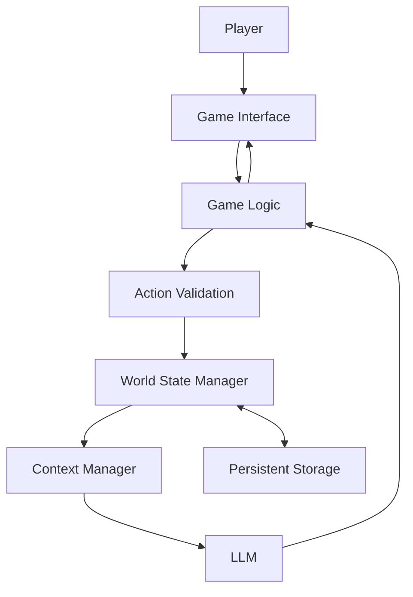

# Implementation of a Consistent Dynamic Game World in a Text Adventure Based on Large Language Models

## 1. Actors and permissions

| Role | Needs | Responsibility / access |
|---|---|---|
| Player | Play an interactive adventure and influence the story through decisions | Starts a game, makes decisions, views the story, and saves or loads progress |
| Game system | Maintain a consistent game world throughout gameplay | Updates the world state, manages game rules, and communicates with the LLM |
| Large language model (LLM) | Receive relevant information to generate suitable narrative content | Generates story text, dialogue, and descriptions based on the provided context |

## 2. Use cases / user stories

### Start and play an adventure

- **Actor:** Player
- **Precondition:** The game is available to the player.
- **Main flow:**
  1. The player starts a new adventure.
  2. The system creates the initial game-world state.
  3. The system provides relevant world information to the LLM.
  4. The LLM generates the opening story.
  5. The player reads the story and chooses an action.
  6. The system checks the action and updates the relevant world state.
  7. The LLM generates the next part of the story using the updated state.
  8. The player continues the adventure.
- **Alternative / error flows:** If an action is invalid, the system does not apply the invalid state change and explains the problem to the player. If the LLM request fails, the system displays an error and allows the player to retry.
- **Postcondition:** The story and game-world state reflect the player's accepted actions.

### Save and load a game

- **Actor:** Player
- **Precondition:** A game session exists.
- **Main flow:**
  1. The player chooses to save the game.
  2. The system stores the current world state and the information needed to continue the session.
  3. Later, the player chooses to load the saved game.
  4. The system restores the saved state.
  5. The player continues the adventure from the saved progress.
- **Alternative / error flows:** If saving or loading fails, the system informs the player and does not silently report success.
- **Postcondition:** The player can continue from the saved game state.

## 3. Functional requirements

| Requirement | Acceptance criteria | Priority |
|---|---|---|
| The player can start a new adventure. | Given the game is available, when the player starts a new game, then the system creates an initial world state and displays the opening story. | Must |
| The system generates narrative using an LLM. | Given a valid game state, when the system requests narrative generation, then the game displays the returned story text. | Must |
| The player can make decisions. | Given the game presents a situation, when the player selects an available action, then the system processes that action. | Must |
| Player decisions can change the world state. | Given an action causes a valid change, when the action is processed, then the corresponding state is updated. | Must |
| The system stores important world information separately from the narrative. | Given the game contains characters, locations, objects, or events, then this information is represented in structured data that the system can read and update. | Must |
| The generated narrative uses relevant world information. | Given a character, object, location, or event has a recorded state, when the system generates a new narrative, then it provides the relevant state information to the LLM. | Must |
| The system handles basic contradictions. | Given an action would create a prohibited state, when the system validates the action, then the invalid change is rejected. | Must |
| The player can save a game. | Given an active session, when the player saves it, then the system stores the current world state and required session information. | Must |
| The player can load a saved game. | Given a valid saved session, when the player loads it, then the system restores the saved state. | Must |
| The system records important events. | Given an important event occurs, when the event is processed, then the system records it for use in later gameplay. | Must |
| The game provides understandable feedback. | Given the player performs an action or an error occurs, then the interface displays the resulting story, status, or error message. | Must |

Priority: **Must** = required for the planned minimum viable product.

## 4. Business rules and constraints

| Rule or constraint | Rationale |
|---|---|
| The application, not the LLM alone, is responsible for the authoritative game-world state. | Prevents generated text from silently changing important game facts. |
| A character cannot be both alive and dead in the same world state. | Prevents a basic logical contradiction. |
| An object can have only one current location or owner at a time. | Prevents the same object from appearing in incompatible places. |
| A player action must be validated before its state changes are applied. | Prevents invalid actions from corrupting the game world. |
| Important state changes must be recorded in structured data. | Allows the system to use reliable information in later turns. |
| Generated narrative should not override a stored fact unless the game rules permit a valid change. | Maintains consistency between the story and the world state. |
| Saved sessions must contain enough information to restore the important game state. | Allows the player to continue later. |
| API keys and other credentials must not be committed to the repository. | Protects private credentials and follows secure development practices. |

## 5. User interface and workflow

The first version will use a simple interface focused on reading the story and making decisions. The player will be able to start a new game, view the current narrative, enter or select an action, and continue playing. Save and load controls will allow the player to continue a previous session.

The initial workflow is:

Start screen → New game or Load game → Read story → Choose action → Validate action → Update world state → Generate next story → Continue or Save.

The interface should also display helpful feedback when an action is invalid or a request fails. The exact layout and interaction details will be decided during the design phase.

## 6. Non-functional requirements

| Requirement | How it will be verified |
|---|---|
| The interface should be understandable to a first-time player. | Conduct a basic usability test with a representative user. |
| Important world-state updates should follow the defined game rules. | Run automated tests for valid and invalid state changes. |
| Saved game sessions should be restorable. | Save a session, reload it, and compare the restored state with the saved state. |
| The system should handle LLM request failures without corrupting the world state. | Simulate a failed request and verify that invalid state changes are not applied. |
| The system should avoid sending unnecessary conversation history to the LLM. | Compare the context size and token usage of the researched approaches. |
| Secret keys and credentials must remain outside version control. | Review repository files and configuration before committing changes. |
| The code and documentation should be maintained in Git. | Review the repository history and project documentation. |

Exact response-time targets and supported session sizes will be defined after the initial technology choices and feasibility research.

## 7. Open questions and risks

| Question / risk | Impact | Owner | Resolution / decision |
|---|---|---|---|
| Which LLM should be used? | Affects cost, response quality, and availability. | Student | Compare suitable API-based and local options before selecting one. |
| How should the game-world state be represented? | Affects consistency and ease of testing. | Student | Design a structured model for characters, locations, objects, and events. |
| Which context or memory-management approaches should be compared? | Affects consistency, token usage, and scalability. | Student | Research at least two approaches and compare them using the same criteria. |
| How much previous conversation should be sent to the LLM? | Too much context may increase token usage; too little may omit relevant details. | Student | Compare conversation-history-based context with structured world-state context. |
| How can contradictions be detected and prevented? | Incorrect state changes can damage the gameplay experience. | Student | Define deterministic validation rules and test important cases. |
| How should game sessions be stored? | Affects save/load functionality and data reliability. | Student | Compare simple persistent storage options and select one suitable for the MVP. |
| What should happen when the LLM returns incorrect or unusable output? | Can interrupt gameplay or produce inconsistent results. | Student | Validate the response and provide a retry or error-handling path. |

## 8. Initial technical specification proposal

### Proposed solution

The proposed system separates game logic and structured world-state management from LLM-generated narrative. The game system stores authoritative facts about characters, locations, objects, and important events. When the player makes a decision, the system validates the action, updates the state when appropriate, and provides relevant information to the LLM. The LLM generates the next part of the story, while the application remains responsible for enforcing game rules.

The application will also support saving and loading sessions. The exact programming language, interface framework, LLM, and storage technology will be selected after comparing feasible options.

### Technology direction

| Area | Candidate technology / approach | Reason for consideration | Open question / risk |
|---|---|---|---|
| Programming language | Python or JavaScript/TypeScript | Both can be used to build an application that communicates with an LLM. | Choose a language and framework suitable for the project and the student's experience. |
| Game interface | Simple web interface | Provides a straightforward way to display narrative and collect player actions. | Decide whether a lightweight frontend framework is necessary. |
| LLM integration | An LLM API or a locally running model | Provides narrative and dialogue generation. | Compare cost, availability, quality, and setup complexity. |
| World-state representation | Structured objects or records | Makes important game facts explicit and easier to validate. | Define the data model and permitted state changes. |
| Persistent storage | JSON files or a small database | Allows game state to survive closing and reopening the application. | Select the simplest reliable option for the MVP. |
| Context management | Conversation history and structured world-state context | Enables comparison of alternative ways to provide information to the LLM. | Evaluate consistency, token usage, and scalability. |
| Version control | Git and GitHub | Tracks source code, documentation, and implementation changes. | Keep credentials and secret configuration out of the repository. |

### Initial architecture sketch

The diagram is an initial proposal, not a final implementation design. The application validates player actions and manages the authoritative world state. The context manager selects relevant information for the LLM. Persistent storage saves the state for later sessions.

### Feasibility and technical risks

| Risk / assumption | Validation planned for semester 2 | Fallback approach |
|---|---|---|
| The selected LLM may produce inconsistent or invalid narrative. | Test generated responses against a small set of known world-state facts. | Use stricter prompts, structured outputs where supported, and deterministic state validation. |
| An LLM API may be unavailable or expensive. | Estimate expected request volume and test a small number of requests. | Use a suitable alternative model or a local model if feasible. |
| The world-state model may become too complicated. | Begin with a small world containing a few characters, locations, objects, and events. | Reduce the number of entity types and rules in the MVP. |
| Long conversation history may consume too many tokens. | Compare conversation history with structured context using representative gameplay examples. | Send relevant state and a short summary instead of the entire history. |
| Save/load may fail to restore the exact state. | Test saving, loading, and comparing representative game sessions. | Use a simpler persistence format and validate stored data. |
| The project scope may become too large. | Implement and test the core gameplay loop before adding optional features. | Prioritize narrative generation, state consistency, and save/load functionality. |

The semester-2 implementation will begin after the specification and initial technical design have been reviewed and refined.
