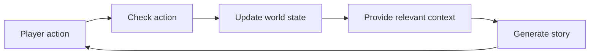
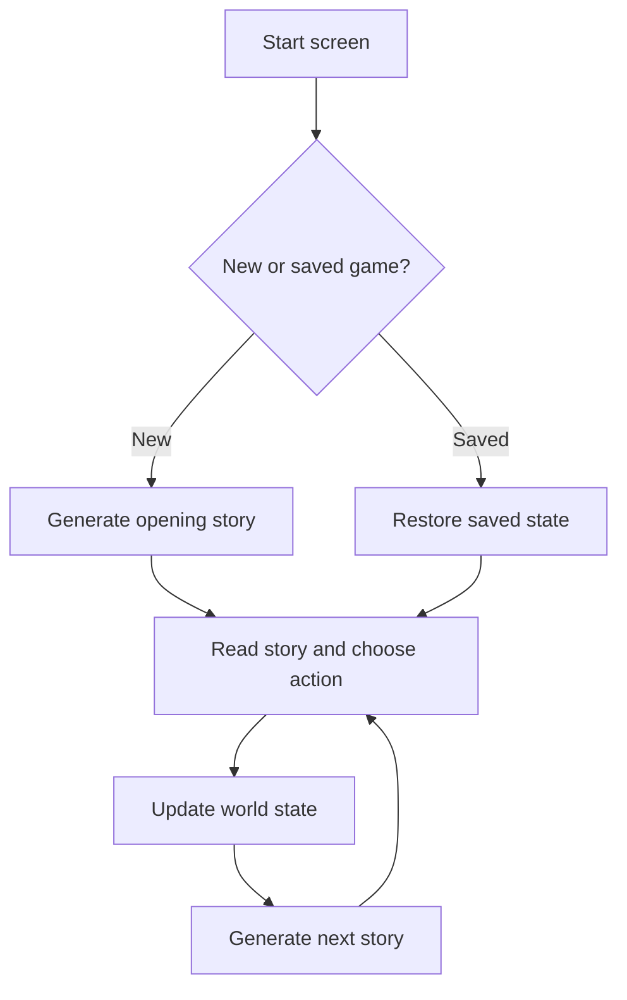
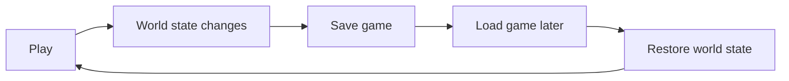

<!-- @slide Title -->

<!-- 5xl -->

# Implementation of a Consistent Dynamic Game World in a Text Adventure Based on Large Language Models

Author: Sodbayar Munkhsaikhan  
Neptun: KO4NHK  
Supervisor: Gábor OLÁH  
Project ID: 2026-OG-02

---

<!-- @slide Problem -->

<!-- @layout AAB -->

## Problem

<!-- @set-align left -->

- Large language models (LLMs) can generate **interesting stories and dialogues**.
- During a long adventure, an LLM may **forget or change important facts**.
- For example, the player picks up a key, but later the story describes the key as still lying on the table.
- This makes the game world feel **inconsistent** and makes player decisions less meaningful.

<!-- @callout question -->

> How can we let an LLM generate a flexible story while keeping the important facts of the game world consistent?

---

<!-- @slide Project idea -->

## From player decisions to a consistent story

The application stores important facts separately from the generated story.

**Example:**  
When the player picks up a key, the application changes the key's location to the player's inventory. The LLM then receives this information when generating the next part of the story.

<!-- @note -->

> **World state:** structured information about the current game, such as character locations, objects, inventory, and important events.

---

<!-- @slide Target users -->

## Target users

<!-- @set-align left -->

**Players** who enjoy interactive, text-based adventure games and want their decisions to influence the story and game world.

Players want to:

- Make choices with meaningful consequences.
- Explore a world with consistent characters and objects.
- Save their progress and continue later.
- Experience a story that responds to previous decisions.

**Stakeholders:**  
The project supervisor and university, who evaluate the project's design and implementation.

---

<!-- @slide Planned scope -->

## Planned scope

<!-- @set-align left -->

<!-- @columns 2 4 -->

### In scope

- LLM-generated stories and dialogue
- Player decisions that change the world
- Structured characters, locations, objects, and events
- Basic consistency and contradiction handling
- Saving and loading game sessions
- Comparison of two context or memory approaches
- Tests for important state-management functions

<!-- @col-break -->

### Out of scope

- Multiplayer gameplay
- Complex 3D graphics
- AI-generated images
- Large automatically generated worlds
- Complex memory systems for many NPCs

<!-- @columns -->

**First version:** a small, single-player adventure with the essential features working reliably.

---

<!-- @slide Rules -->

## Rules behind the game world

<!-- @set-align left -->

1. **The application controls important facts.**  
   The LLM does not independently decide the stored world state.

2. **Actions are checked before the state changes.**  
   Invalid actions should not create impossible situations.

3. **Important facts stay consistent.**  
   An object cannot be in the player's inventory and on a table at the same time.

4. **The story uses the current world state.**  
   Relevant information is provided to the LLM before generation.

5. **Saving preserves progress.**  
   Loading a game restores the important game information, not only the story text.

<!-- @note -->

> These are planned design rules, not implemented or tested features yet.

---

<!-- @slide User journey -->

## User journey: Start and play

### Main flow

1. Start a new adventure or load a saved game.
2. Read the current story.
3. Choose an action.
4. Update the game-world state.
5. Generate the next part of the story.

---

<!-- @slide Save journey -->

## User journey: Save and continue

### Save flow

- The player makes decisions.
- The game state changes.
- The player saves the game.
- The system stores the current state.
- Later, the player loads the game and continues from that state.

---

<!-- @slide Research -->

## Research and next steps

<!-- @set-align left -->

1. **Define the world model**  
   Decide how characters, locations, objects, inventory, and events will be represented.

2. **Compare two context or memory approaches**  
   Evaluate consistency, token usage, and scalability.

3. **Define LLM interaction**  
   Decide which world information and conversation history should be sent to the LLM.

4. **Design consistency checks and saving**  
   Decide how to prevent invalid state changes and how games will be saved and loaded.

5. **Prepare for Semester 2**  
   Select suitable technologies and implement the planned core features.

---

<!-- @slide Goal -->

## Semester 1 goal

### Specification before implementation

The main goal of this semester is to produce:

- A clear world-state model
- A realistic technical architecture
- A defined LLM interaction strategy
- A plan for consistency checking
- A plan for saving and loading
- A comparison of context/memory approaches

**Implementation of the core system will begin in Semester 2.**

---

<!-- @slide End -->

## Thank you

Questions and feedback are welcome.
